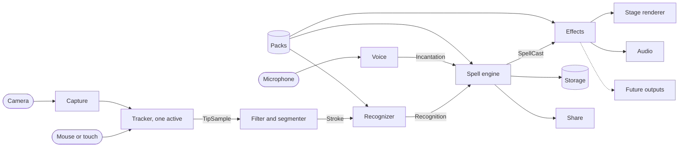
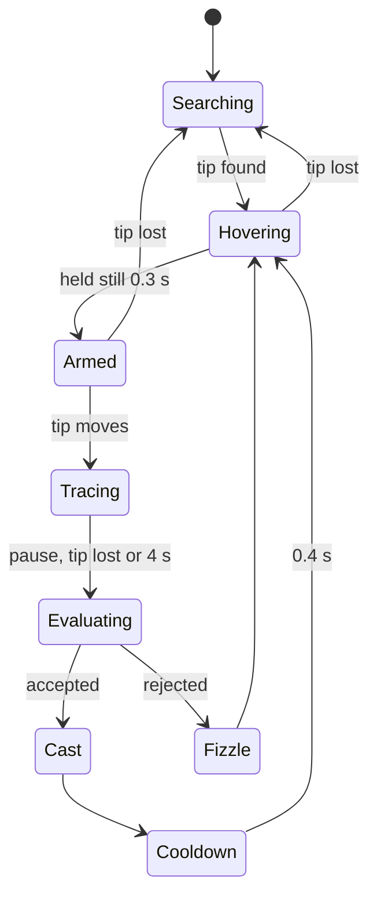
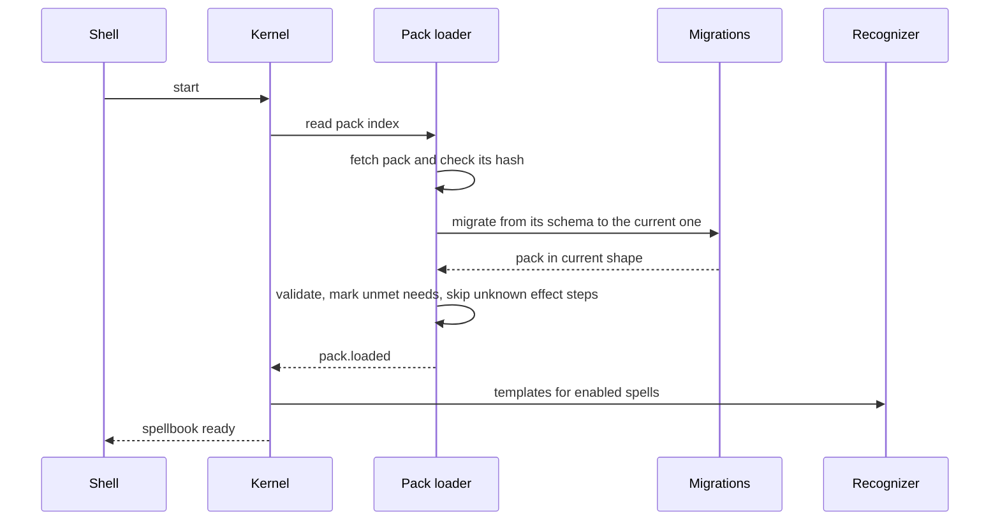

# Spellglass

**Blueprint for a wand-and-webcam spell-casting app**

Version 1.0, 19 November 2026. Research and architecture only; no code has been written. "Spellglass" is a working title.

## Contents

1. [Summary](#1-summary)
2. [Goals and limits](#2-goals-and-limits)
3. [What is known about the wand](#3-what-is-known-about-the-wand)
4. [Tracking the wand at home](#4-tracking-the-wand-at-home)
5. [Architecture](#5-architecture)
6. [Contracts](#6-contracts)
7. [The pipeline in detail](#7-the-pipeline-in-detail)
8. [Spellbook](#8-spellbook)
9. [Forward-compatible updates](#9-forward-compatible-updates)
10. [Interface](#10-interface)
11. [Sharing, privacy and safety](#11-sharing-privacy-and-safety)
12. [Stack and repository](#12-stack-and-repository)
13. [Tests and budgets](#13-tests-and-budgets)
14. [Roadmap](#14-roadmap)
15. [Risks, trade-offs and what to revisit](#15-risks-trade-offs-and-what-to-revisit)

Appendices: [A. Tracking test](#appendix-a-tracking-test) · [B. Seed gestures](#appendix-b-seed-gestures) · [C. Sources](#appendix-c-sources)

---

## 1. Summary

Spellglass is a browser app. It watches a Universal Second Generation interactive wand through the computer's camera, recognizes the spell you trace in the air (and, if you like, say aloud), and answers on screen with light, sound and a small room of objects that react.

The research changed the plan in one important way. The wand's light and vibration respond to the parks' equipment, and nothing public shows how to trigger them at home. So the app treats the wand the way the park cameras do: as a stick with a reflective tip to follow. All feedback comes from the screen and the speakers.

| Decision | Choice | Reason |
|---|---|---|
| Platform | Static web app, installable, desktop Chrome or Edge first | A link is the easiest thing to share, and the browser already has the camera, graphics and speech features needed |
| Finding the wand | Follow the glint of the tip, lit by a small light beside the lens. Hand tracking is the no-hardware fallback; an infrared webcam is the upgrade | Same principle as the parks. A one-evening test picks the default ([Appendix A](#appendix-a-tracking-test)) |
| Recognizing spells | Template matching on the traced path, with a fast path for straight flicks | Works from one example per spell, lets you redraw any gesture, and fails in ways that can be explained to the player |
| Spells | 24 in two packs, plus an optional pack of 3 | Covers the most-cast spells in the books and several from the park list |
| Voice | Optional spoken incantation, recognized on the device | Adds to the fun and raises accuracy; no audio is uploaded |
| Updates | Spells, gestures, effects and themes are data packs with schema versions. Code modules meet at versioned contracts | New content never needs a code change, and old packs keep loading |
| Look | "Candlelit mirror": your reflection is the stage | It is what a camera app actually shows, dressed with original art and open fonts |
| Sharing | The app by link; each cast as a replay link, a card or a clip; packs as files | No server, no accounts, and no camera footage unless you choose |

**Start with [Appendix A](#appendix-a-tracking-test).** It takes one evening, costs nothing and settles the largest unknown: whether your camera can see the wand tip.

How the brief maps to this document:

| You asked for | Where it is answered |
|---|---|
| Spell-casting at home through the computer's camera | Sections 3, 4 and 7 |
| The most common spells | Section 8 |
| Updates that are modular and forward compatible | Sections 5, 6 and 9 |
| A Harry Potter style interface | Section 10 |
| Output that is easy to share | Section 11 |

"Easy to share" could mean the app, what the app produces, or this document. The plan covers all three, and any one can be dropped without touching the core.

---

## 2. Goals and limits

**What it must do**

1. Track the wand tip with an ordinary laptop or USB camera.
2. Recognize 24 common spells from the traced shape, the 12 core spells first, with the spoken incantation as an option.
3. Answer within a moment, on screen and in sound, inside a themed interface.
4. Teach: a spellbook with animated strokes and a practice mode that grades each attempt.
5. Take new spells, themes, trackers, recognizers and outputs later without rewriting what exists.
6. Share: the app by link, casts as replays, packs as files.

**Targets** (to be measured in the first two milestones, not promised)

| Quality | Target |
|---|---|
| Delay from wand motion to trail on screen | 150 ms or less with a 30 fps camera, 100 ms or less at 60 fps |
| Delay from end of stroke to spell decision | 50 ms or less |
| Correct spell, 12 core spells, your own recorded casts | 95% or more with the shipped gestures, 97% or more once the app has learned yours |
| Wrong spell fired | 1% or less (a fizzle is better than the wrong spell) |
| First download | 3 MB or less, before the optional hand-tracking model |
| Rendering | 60 fps on a laptop with integrated graphics |
| Offline | Fully usable after the first visit |

**Out of scope**

- Driving the wand's own light or vibration, or talking to its radio.
- Copying the parks' effects, artwork, app or branding.
- Phones as the main device. The design allows it later; desktop comes first.
- Multiplayer in the first version.

**Assumptions**

- A1. You use Chrome or Edge on a laptop or desktop. Other browsers work with fewer features (no exposure control, patchier speech recognition).
- A2. The Gen 2 tip still reflects light back toward its source, since it works at every camera-tracked window in the parks. Whether a visible-light webcam sees that reflection well enough is not known yet.
- A3. One developer, probably working with an AI coding assistant. That is why the contracts and the exit criteria are written out.
- A4. A non-commercial fan project.

---

## 3. What is known about the wand

| Topic | Finding | Source |
|---|---|---|
| Release and price | On sale since 1 March 2025 at about $85, including at Cosme Acajor Baguettes Magique in Place Cachée | [Inside Universal][iu-launch], [Universal store][uo-store] |
| What is new | The tip lights up and the wand vibrates when a cast succeeds; the tip color follows the spell (red for Incendio, blue for Aguamenti) | [TouringPlans][touringplans], [Inside Universal review][iu-review] |
| Power | One AAAA (LR8) cell, included, swapped through a small divot at the base. Reported life is 2,000 to 3,000 casts | [Undercover Tourist][uct], [Unofficial Guides][tug], [ThemeParkPro][tpp] |
| App link | Paired to the Universal Play feature of the park app by scanning the box barcode or holding the wand to the phone. One guide calls this NFC; a reseller's copy of the instructions says Bluetooth | [TouringPlans][touringplans], [MagicGuides][magicguides], [reseller listing][ebay] |
| Compatibility | Works at every spell location. First-generation wands still work at the older ones, which implies the camera tracking is unchanged | [ThemeParkPro][tpp], [Unofficial Guides][tug] |
| How the parks track it | An infrared emitter lights the scene, the tip sends the light straight back, a camera follows the bright dot, and a controller compares the path with stored gesture paths. Guests are told to aim at four red dots | [Universal patent][patent-track], [Orlando Informer][oi] |
| The tip | A translucent half-sphere. A hobbyist measured a first-generation dome at 4 mm | [Orlando Informer][oi], [comment on W. Osman's write-up][osman] |
| Works with IR at home | A forum member lit an interactive wand's tip with night-vision illuminators at home and saw it glow | [RPF forum][rpf] |
| Park advice on casting | Orlando: small motions from the wrist. Osaka: slow, controlled motions from the arm | [Orlando Informer][oi], [USJ guide][usj] |
| Spells at Epic Universe | Lumos, Incendio, Revelio, Specialis Revelio, Rennervate, Descendo, Ventus, Lumos Maxima, Titillando, Locomotor and Accio across 12 spots | [WDWNT][wdwnt-spots] |

**Not public**

- How a spell location tells the wand that a cast succeeded. A Universal patent describes finding an object by its retro-reflector and then aiming a second infrared emission at it, which the object harvests to power its light or haptics, through a reflector that passes infrared and is at least partly opaque to visible light ([US 12,061,351][patent-object]). Whether the retail wand works this way is not documented.
- Whether the tip can be lit away from park hardware. No source shows it.
- The radio protocol behind the app pairing.

**What this means for the design**

1. Treat the wand as a passive optical marker. The app never depends on the wand's electronics.
2. A reflector that blocks visible light, as that patent allows, would defeat a visible-light tracker. The visible glint is a real unknown, so test it before building around it.
3. Light, sound and score come from the app. The wand stays a prop that happens to be easy to track.

---

## 4. Tracking the wand at home

Every home build of the park system found during research uses the same recipe: an infrared-sensitive camera, infrared LEDs beside it, and a bright-dot tracker ([Hackaday][hackaday-thole], [Raspberry Pi magazine][rpi-mag], [Potter Pi][potterpi], [Make][makezine], [LearnOpenCV][learnopencv]). A laptop webcam filters out most infrared, so the plan offers four routes that all feed the same downstream pipeline.

| Route | Extra kit | How it works | Good | Weak | Status |
|---|---|---|---|---|---|
| A. Visible glint | A small light touching the bezel beside the lens (phone flashlight or clip-on LED), or a white band on the screen under the camera | Retro-reflectors send light back toward its source, so a light next to the lens makes the tip the brightest dot. Lower the exposure and track the dot | Uses your real wand tip; nothing to buy | Unproven for this tip; needs a dim room and a steady light | Test first |
| B. Hand tracking | None | A hand-landmark model follows your hand or fingertip; the wand is a prop | Works anywhere, and for friends with no wand | Follows the hand, not the tip, so wrist flicks are lost | Fallback, always shipped |
| C. Infrared, as in the parks | A USB camera that sees infrared and carries 850 nm LEDs around its lens, from about $35 ([example][arducam]) | Identical to route A, in a band where the room is dark | The most robust option; what the home builds use | A purchase and a second camera | Upgrade |
| D. Wand electronics | None | Read motion from the wand itself | Would need no camera | Undocumented, could change, tied to Universal's app | Not planned; the slot exists |

Notes on the routes:

- **Why the light must hug the lens.** A retro-reflector returns light in a narrow cone around the source. Robotics teams that track retro-reflective targets mount a ring light around the lens for this reason ([WPILib][wpilib]). At 1 m, a light 2 cm from the lens sits about 1.1° off the camera's line of sight; at 10 cm it is 5.7° off and the glint will fade. Moving the light away and watching the dot dim is also the quickest proof that you are seeing retro-reflection.
- **Size of the dot.** A webcam with a 60° to 78° horizontal field of view covers 1.2 to 1.6 m of width at 1 m. A 4 mm tip is then 3 to 4.5 pixels wide in a 1280-pixel frame and 5 to 7 in a 1920-pixel frame, before any glare. A 40 cm gesture spans roughly 320 to 440 pixels at 1280. So: capture at 1920 × 1080 when the camera offers it at 30 fps, and stand 0.6 to 1.2 m away.
- **Buying for route C.** Day-and-night USB cameras switch to infrared only when their light sensor sees a dark room. Dim the room or cover the sensor to hold the camera in infrared mode.
- **A free version of route C on some laptops.** Laptops with face unlock have an infrared camera and emitter. Browsers sometimes list that camera as a second device ([W3C issue][w3c-ir], [webcamtest][webcamtest]). If yours appears in the camera picker, try it; it is unreliable enough to be a bonus, not a plan.
- **Friends without a Universal wand.** Any stick with a dab of retro-reflective tape works for routes A and C, which is how home builders make spare wands ([Hackaday][hackaday-thole]). Route B needs nothing.

**Decision gate.** Run [Appendix A](#appendix-a-tracking-test). If the glint is clear, route A is the default. If not, route B is the default and route C is the recommended upgrade. Nothing after the tracker changes either way, because every route emits the same `TipSample` stream (Section 6).

---

## 5. Architecture

The app is a pipeline of small modules around an event bus. Each module does one job, declares what it provides and needs, and speaks only through the contracts in Section 6.



| Module | Job | First implementation | Later swap-ins |
|---|---|---|---|
| Capture | Open the camera, set exposure, hand frames on | `getUserMedia` with `requestVideoFrameCallback` | `MediaStreamTrackProcessor` in a worker where available |
| Tracker | Frames to tip positions | Bright-tip tracker in a worker | Hand tracker, pointer (mouse or touch), replay (recorded sessions), infrared profile |
| Filter and segmenter | Tip positions to strokes | One Euro filter and a hold-still segmenter | Always-on windows, voice-bounded strokes |
| Recognizer | Stroke to ranked spells | Flick detector and template matcher | Small neural network, run in shadow first |
| Voice | Speech to incantations | On-device Web Speech API | Keyword-spotting model |
| Spell engine | Combine gesture and voice, apply spell rules, score the cast | Rule based | Duel logic |
| Effects | Cast to picture and sound | Stage renderer and audio | Smart lights, stream overlays |
| Packs | Load, check and migrate content | JSON packs bundled with the app | Packs from any URL |
| Storage | Camera profiles, your gesture samples, progress | IndexedDB | Export and import |
| Share | Replay links, cards, clips | URL fragment and canvas capture | Nothing planned |
| Shell | Screens and theme | Svelte | Any framework |

A small **kernel** holds the event bus, the module registry and lifecycle, feature detection, settings and the pack loader.

**Dependency rule.** `contracts` depends on nothing. `kernel` depends on `contracts`. Modules depend on `kernel` and `contracts` and never on each other. The shell talks to the kernel. One file, `main.ts`, wires modules together. A lint rule fails the build when an import breaks this.

**Threads.** The main thread runs the interface and the stage. The tracker runs in a worker so a slow frame never stalls the trail. The hand model, when used, gets its own worker.

---

## 6. Contracts

These types are the only thing modules share. Within version 1, changes are additive.

```ts
// contracts/v1.ts
export const CONTRACT = '1.0';

/** One observation of the wand tip.
 *  Caster space: x runs 0 to 1 from left to right as you see yourself in the
 *  mirror view; y runs 0 to 1 from top to bottom. t is capture time in ms. */
export interface TipSample {
  t: number;
  x: number;
  y: number;
  conf: number;            // 0..1
  src: string;             // tracker id
  size?: number;           // blob radius, normalized; an optional depth hint
}

export interface Stroke {
  id: string;
  points: TipSample[];     // filtered, in time order
  t0: number;
  t1: number;
  quality: number;         // 0..1, lowered by dropouts and jitter
}

export interface Recognition {
  strokeId: string;
  recognizer: string;
  candidates: { spellId: string; score: number }[];   // best first, score 0..1
}

export interface Incantation {
  t: number;
  text: string;
  spellId?: string;
  conf: number;
  final: boolean;
}

export interface SpellCast {
  id: string;
  spellId: string;
  t: number;
  via: 'gesture' | 'voice' | 'both';
  quality: number;         // 0..1; the theme turns this into a grade
  power: number;           // 0..1, from stroke size and speed
  aim: { x: number; y: number };
  strokeId?: string;
}
```

```ts
// contracts/module.ts
export type ModuleKind =
  | 'tracker' | 'segmenter' | 'recognizer' | 'voice'
  | 'engine' | 'effect' | 'scene' | 'share' | 'storage';

export interface ModuleManifest {
  id: string;              // 'tracker.bright-tip'
  kind: ModuleKind;
  version: string;         // semantic version of this module
  contract: string;        // contract range it speaks, e.g. '^1.0'
  provides: string[];      // capabilities, e.g. ['tip.source']
  requires?: string[];     // e.g. ['platform.camera']
}

export interface Envelope<T = unknown> {
  type: string;            // 'tip.sample', 'spell.cast', ...
  v: number;               // payload version for this type
  t: number;
  source: string;          // module id
  payload: T;
}

export interface Kernel {
  publish<T>(e: Envelope<T>): void;
  subscribe<T>(type: string, fn: (e: Envelope<T>) => void): () => void;
  has(capability: string): boolean;
  setting<T>(key: string, fallback: T): T;
}

export interface Module {
  manifest: ModuleManifest;
  init(kernel: Kernel): Promise<void>;
  start(): Promise<void>;
  stop(): Promise<void>;
}
```

**Event types in version 1**

| Type | Payload | Sent by |
|---|---|---|
| `tip.sample`, `tip.found`, `tip.lost` | `TipSample` or none | Tracker |
| `tracker.status` | Lock quality, frame rate, exposure state | Tracker |
| `stroke.begin`, `stroke.end` | `Stroke` | Segmenter |
| `recognition.result` | `Recognition` | Recognizer |
| `voice.incantation` | `Incantation` | Voice |
| `spell.cast`, `spell.fizzle` | `SpellCast`, or the nearest candidate and a hint | Spell engine |
| `effect.start`, `effect.end` | Spell id and effect id | Effects |
| `pack.loaded` | Pack id, version, unmet needs | Pack loader |
| `app.update-ready` | New version | Shell |

**Two conventions that prevent a class of bugs**

- *Caster space.* A camera facing you sees your right hand on its left. Trackers flip x once, at the source, so everything after the tracker works in the mirror view you see on screen.
- *Capture time.* `t` is the timestamp of the camera frame, not the time the code ran. Gesture and voice are lined up on this clock.

---

## 7. The pipeline in detail

### 7.1 Capture

- Ask for 1920 × 1080 at 30 fps or better, falling back to 1280 × 720. Prefer 60 fps when the camera offers it at either size.
- Drive processing from `requestVideoFrameCallback`, which every major browser has supported since late 2024 ([web-features][rvfc]). `MediaStreamTrackProcessor` can hand frames to a worker more directly, but its support is limited and differs between Chromium and Safari, so it is an optional fast path ([MDN][mstp]).
- Lock exposure when the camera allows it. Chromium exposes `exposureMode` and `exposureTime` through `applyConstraints` for cameras that support them; read the allowed range from `getCapabilities()` and treat the control as optional ([webrtcHacks][webrtchacks]). A short, fixed exposure turns the room dark, keeps the glint, and removes motion blur.
- Save the working settings per camera as a profile.

### 7.2 Bright-tip tracker (routes A and C)

Per frame, in a worker:

1. Take brightness, or the color channel of the light if the light is colored; a colored light tints the reflection, which separates the tip from white lamps. Shrink to a search size (about 640 × 360) by keeping the brightest pixel of each block, so a glint only a few pixels wide survives.
2. Mark pixels that are brighter than both a fixed floor and the frame mean plus *k* standard deviations.
3. Remove known static bright areas using a slow-moving mask of lamps, windows and reflections in glasses.
4. Group the remaining pixels into blobs. Keep blobs with a plausible area and a roughly round shape.
5. Score each blob by brightness, roundness and distance from where the last few samples predict the tip to be. Take the best. If nothing passes for several frames, announce `tip.lost` and search the whole frame again.
6. Refine the winner to sub-pixel precision with a brightness-weighted centroid at full resolution.
7. Flip x into caster space and publish a `TipSample` with a confidence.

| Setting | Starting value |
|---|---|
| *k* in the brightness threshold | 4 |
| Blob area at full resolution | 4 to 400 px² |
| Search radius around the predicted position at 30 fps | 12% of frame width per frame |
| Misses before the tip is declared lost | 6 frames |

An optional aid for a cluttered room: blink the on-screen light for a few frames and keep only the blob that blinks with it. This is an experiment, not a dependency.

### 7.3 Hand tracker (route B)

MediaPipe's Hand Landmarker runs in the browser through the `@mediapipe/tasks-vision` package, with a video mode for camera streams and a GPU option ([Google AI Edge][mp-hand]). Use one hand, video mode, in a worker. Two tip definitions:

- *Finger mode:* the index fingertip is the wand. Best for visitors without a wand.
- *Grip mode:* a point projected forward from the knuckles of the hand holding the wand. It needs tuning in the first milestone.

The model is several megabytes, so it loads only when this tracker is chosen. Two existing projects use hand tracking for spell gestures ([spellcatcher][spellcatcher], [i_wizard][iwizard]).

### 7.4 Filtering and segmentation

Raw positions pass through a One Euro filter, an adaptive low-pass filter that smooths hard when the tip is slow and backs off when it is fast, with two parameters and a published tuning recipe ([Casiez et al.][oneeuro]).

A camera never sees a pen lift, so the app needs a rule for where a stroke starts and ends. The default is hold-still: pause, trace, pause.



| Setting | Starting value |
|---|---|
| Hold that arms a cast (the on-screen tip turns gold and ticks) | 0.3 s within 2% of frame width |
| End of stroke | 0.25 s pause, or 0.2 s without the tip, or 4 s in total |
| Shortest stroke worth evaluating | 8 samples and 15% of the play area |

Two other segmenters fit the same contract and can be added later: always-on (evaluate the recent path at every pause) and voice-bounded (take the stroke around a spoken incantation).

### 7.5 Recognizer

The recognizer is a member of the "$-family" of gesture recognizers, adjusted for wand strokes. The original $1 recognizer is a nearest-neighbor template matcher of about 100 lines that reached over 97% accuracy with one example per gesture and 99% with three or more in its authors' study ([Wobbrock, Wilson and Li][dollar-paper], [project page][dollar]).

**Stage 1: flicks.** Compute the stroke's *linearity*: the ratio of its narrow spread to its long spread, taken as the standard deviations along its two principal axes. At 0.20 or less the stroke is a straight flick, and its spell is whichever of up, down, left or right lies within 35° of the start-to-end direction. A straight stroke in any other direction, or in a direction with no enabled spell, goes on to stage 2.

**Stage 2: templates.**

1. Resample the stroke to 64 points evenly spaced along its length.
2. Move its center of mass to the origin.
3. Scale it uniformly so the longer side of its bounding box is 1.
4. Against every template of every enabled spell, take the mean point-to-point distance, minimized over rotations within ±15° in 3° steps.
5. Score = 1 − distance ÷ 0.707. Straight-line templates take part only when linearity is under 0.30.

**Decision.** Accept the best spell if its score is at least 0.72 and it leads the runner-up by at least 0.04. Otherwise the cast fizzles, and the app names the nearest spell and shows where the stroke strayed.

**How this differs from textbook $1, and why**

| Change | Reason |
|---|---|
| No rotation to a reference angle; only ±15° of tolerance | Orientation carries meaning here: up is Lumos, down is Nox |
| Uniform scaling | Keeps tall and wide shapes distinct, and avoids $1's trouble with nearly straight strokes |
| Direction matters | The point-cloud relatives ($P, $Q) ignore stroke direction by design, which would merge opposite flicks ([project page][dollar]) |
| Several start points for closed shapes | People start a circle anywhere |
| Straight flicks handled separately | Lines look a little like every elongated shape to a point matcher |

**Learning your hand.** After three accepted casts of a spell, the app keeps those strokes on your device as extra templates for that spell. The shipped templates stay untouched.

**Simulated check of the seed set.** The gestures in Section 8 were tested with 400 synthetic casts per spell. Each cast was distorted with tilt (6° standard deviation), independent stretch on each axis (12%), shear, slow wobble, rounded corners, ragged starts and ends, and 30 to 70 jittered samples.

| Set | Rule | Correct | Wrong | Fizzled |
|---|---|---|---|---|
| 12 core | Best match wins | over 99.9% | under 0.1% | none |
| 24 | Best match wins | 99.8% | 0.2% | none |
| 24 | Thresholds above | 99.2% | under 0.1% | 0.8% |
| 24, noise × 1.5 | Best match wins | 97.3% | 2.7% | none |
| 24, noise × 1.5 | Thresholds above | 92.1% | 0.8% | 7.1% |
| All 27 | Best match wins | 99.8% | 0.2% | none |

This is a simulation with an invented noise model. It shows the shapes are far enough apart; it does not show how you will draw them. The real gate is your own recorded casts (Section 13). Under heavy noise the weakest three are Arresto Momentum, Wingardium Leviosa and Incendio.

**Pack lint.** A pack fails its check if any two of its non-line templates score above 0.80 against each other. The closest pair in the seed set scores 0.77. The simulation and this check belong in `tools/gesture-lab`, so both run again whenever a pack changes.

### 7.6 Voice

The Web Speech API now supports on-device recognition and phrase hints, both shipped in Chrome during 2025 ([W3C update][tpac]).

- Set `processLocally` so audio and transcripts stay on the device. Check `SpeechRecognition.available()` first and call `install()` to fetch the language pack when it reports one is downloadable ([MDN][mdn-speech]).
- Pass the enabled incantations as `phrases` with a boost, so invented words are favored over near-sounding English ([MDN][mdn-speech]).
- Keep a second line of defense that does not depend on phrase hints: each spell lists `heard_as` mishearings, and a fuzzy matcher compares the transcript with those.
- If on-device recognition is unavailable, voice stays off unless you opt in to the browser's server-based service, with a plain statement that audio then leaves the device.

### 7.7 Spell engine

**Combining gesture and voice**

| Mode | A spell is cast when | For |
|---|---|---|
| Gesture (default) | The stroke passes the thresholds | Everyday play |
| Assisted | An incantation is heard between 2.5 s before and 1 s after the stroke. That spell is accepted at a lower score (0.60) and others are ignored | Beginners, poor tracking |
| Strict | Stroke and incantation agree | Purists |
| Voice only | The incantation alone | Accessibility, or no wand in view |

**Rules come from pack data, not code.** A spell may declare what must be active first (`needs_active`: Nox needs Lumos), what it ends (`ends`), what ends it (`ended_by`), what it acts on (`targets`) and a cooldown.

**Quality and power.** Quality (0 to 1) blends the match score with smoothness and tempo. The theme turns it into a grade. Power (0 to 1) comes from stroke size and speed relative to your calibrated play area. A pack can map a power band to a variant, such as a brighter Lumos above 0.8.

### 7.8 Effects and scene

**The stage.** The live camera image is the mirror. Along its bottom edge sits a shelf of props that give every spell something to act on: a candle, a feather, a locked box, a cracked teacup, a potted plant and a wooden training dummy. Effects that belong to the wand are drawn on your reflection at the tracked tip, which is the moment that sells the illusion: you cast Lumos and the tip of your real wand lights up in the mirror while the room darkens around it.

**Effects are data.** A spell's effect is a list of steps built from a fixed set of primitives. Packs never contain code.

| Group | Primitives in version 1 |
|---|---|
| Light | `light.orb`, `light.flash`, `light.snuff`, `scene.dim` |
| Particles | `particles.burst`, `particles.stream` with presets (sparks, embers, water, mist, stars) |
| Props | `prop.levitate`, `prop.pull`, `prop.push`, `prop.unlock`, `prop.mend`, `prop.ignite`, `prop.douse`, `prop.freeze`, `prop.scale`, `prop.costume` |
| Shapes | `shield.dome`, `bolt.cast`, `creature.summon` |
| Whole scene | `time.slow`, `screen.shake`, `effects.end` |
| Sound and text | `audio.cue`, `audio.muffle`, `text.inscribe` |

**Targets.** A spell that acts on something picks the prop nearest to where the stroke ended.

**Other outputs later.** An output is a module that listens for `spell.cast`. A settings table of *bindings* maps a spell to an extra action, so "Lumos also turns on the desk lamp" is a row of data. For Home Assistant, a webhook trigger accepts a POST with no token and is local-only by default, and its documentation warns against binding it to locks or doors ([Home Assistant][ha-webhook]). Chrome asks permission before a public page may call a device on your home network ([Chrome][lna]), so this output is opt-in and belongs to a late milestone.

### 7.9 When things go wrong

| Situation | What the app does |
|---|---|
| Camera permission refused, or no camera | Explains how to allow it, and offers pointer mode (mouse or touch) so the rest of the app still works |
| Tip lost in the middle of a stroke | Ends the stroke after 0.2 s and evaluates what it has. After 3 s without a tip it shows the "tip not found" hint |
| Frame rate falls below 20 fps | Steps the capture size down once and says so in the status area |
| A pack fails its checks | Skips that pack, gives the reason in the Workshop screen, and keeps the others |
| A spell needs something that is missing | Lists the spell as unavailable, with the reason |
| Speech recognition is unavailable | Voice stays off; gesture play is unaffected |
| Storage is blocked or full | Runs without saving and says so |

---

## 8. Spellbook

Which spells count as "most common" is settled well enough by two tallies of the books: Pottermore's own word cloud put Stupefy, Expelliarmus, Lumos, Accio and Expecto Patronum on top, and an independent count has the same attack-and-defense spells near the top ([MuggleNet][mugglenet], [Inverse][inverse]). The core pack holds those five plus the school-room and film favorites. Gestures are described as you see them in the mirror.

**Basis** says where a gesture comes from: *Story* follows the well-known description, *Park* follows a shape used at a Universal park, *List* follows a published wand-motion list, and *App* was designed for this app.

### Core charms (pack 1)

| Spell | Known as | Gesture | On screen | Basis |
|---|---|---|---|---|
| Lumos | Wand-lighting charm | Flick straight up | Your wand tip ignites; the room dims around it | App |
| Nox | Puts the light out | Flick straight down | The light snuffs; the room returns | App |
| Wingardium Leviosa | Levitation charm | Arc over from left to right, then drop straight down: "swish and flick" | The feather lifts and follows your tip | Story |
| Alohomora | Unlocking charm | Circle clockwise from the top, then straight down through it | The box unlatches and opens | Park ([USJ][usj]) |
| Accio | Summoning charm | A "C": from upper right, around the left, to lower right | The nearest object flies to your tip | App |
| Expelliarmus | Disarming charm | A check mark: short stroke down-right, long flick up-right | A scarlet bolt; the dummy's wand spins away | App |
| Stupefy | Stunning spell | Flick left to right | A red flash; the dummy reels | App |
| Protego | Shield charm | A circle, clockwise, from any point | A rippling dome holds for five seconds | App |
| Expecto Patronum | Patronus charm | Spiral outward from the center, two turns clockwise | A silver creature bursts out and circles the frame | App |
| Reparo | Mending charm | A figure-eight on its side, starting at the center | The cracked teacup knits together | App |
| Incendio | Fire-making spell | A triangle: up to the point, down, back along the base | The candle and hearth catch | Park ([USJ][usj]) |
| Aguamenti | Water-making spell | One wave from left to right: up, down, up | A water arc from the tip; flames go out | List ([source][ft]) |

### Further spells (pack 2)

| Spell | Known as | Gesture | On screen | Basis |
|---|---|---|---|---|
| Petrificus Totalus | Full body-bind | A "P": straight up, then a bowl around to the middle | The dummy snaps rigid and topples | App |
| Impedimenta | Slows or stops a target | A "J": straight down, hook to the left | The dummy moves in slow motion | App |
| Riddikulus | Makes a Boggart laughable | A "W" | The dummy gets a silly costume | App |
| Revelio | Reveals what is hidden | A question mark: hook over the top, then straight down | Hidden ink and objects shimmer into view | App |
| Finite Incantatem | Ends spell effects | Flick right to left | Every active effect ends | App |
| Obliviate | Memory charm | Spiral inward, two turns clockwise | Trails and the session log fade away | App |
| Reducto | Blasts solid objects | A one-stroke "X": down-right, straight up, down-left | The target bursts to dust; Reparo restores it | App |
| Arresto Momentum | Slows moving things | An "M" from the lower left | Everything in motion slows to a stop | Park ([USJ][usj]) |
| Muffliato | Fills nearby ears with buzzing | A "6": down the left side, then close a loop at the bottom | Sound is muffled until Finite | App |
| Locomotor | Moves objects | An "L": down, then right | The target slides wherever you point | App (the Orlando park uses a figure-four, per [Unofficial Guides][tug]) |
| Engorgio | Enlarges | A caret: up, then down | The target grows | App |
| Reducio | Shrinks | A vee: down, then up | The target shrinks | App |

### Restricted section (optional pack, off by default)

The three Unforgivable Curses are among the best-known spells, so they are available, kept apart, and drawn as abstract light and sound on the wooden dummy.

| Spell | Gesture | On screen |
|---|---|---|
| Imperio | An upright figure-eight from the top | The dummy copies your wand's movement |
| Crucio | A five-point star from the top | A red crackle; the dummy recoils |
| Avada Kedavra | A lightning bolt: down-left, right, down-left | A green flash; the dummy drops |

### Notes on the set

- **Why most gestures are original.** Most book spells have no agreed wand motion, and the parks do not agree with each other. Alohomora is a circle and a downstroke in Osaka ([USJ][usj]), a triangle in one Orlando guide ([Be Prepared Vacations][bpv]) and a backward S in a published wand-motion list ([list][ft]). The seed set borrows park shapes where one fits and designs the rest to be easy to remember and hard to confuse.
- **Every gesture is data.** You can redraw any of them in the Workshop screen. Exact seed paths are in [Appendix B](#appendix-b-seed-gestures).
- **Spells interact.** Nox needs Lumos. Aguamenti puts out Incendio. Reparo restores what Reducto broke. Finite Incantatem ends everything. A large, fast Lumos becomes the brighter variant.
- **Only enabled spells are candidates.** Practice mode unlocks spells in stages, which keeps the candidate list short while you learn and raises accuracy.
- **Overlap with Epic Universe.** Lumos, Incendio, Revelio, Accio and Locomotor are cast in Place Cachée too ([WDWNT][wdwnt-spots]). The park's shapes are on its medallions and may differ from these.
- **Backlog for later packs.** Episkey, Scourgify, Diffindo, Confundo, Levicorpus, Silencio, Sonorus, Avis, Orchideous, Ventus, Descendo, Ascendio, Glacius, Herbivicus, Tarantallegra, Rictusempra, Rennervate, Depulso.

---

## 9. Forward-compatible updates

Three layers change at different speeds, and each has its own versioning.

| Layer | Changes | Versioned by | Example |
|---|---|---|---|
| Packs (data) | Often | `schema` and `version` in each pack | A new spell, a redrawn gesture, a theme |
| Modules (code) | Sometimes | Semantic version, plus the contract range the module speaks | A better tracker |
| Contracts | Rarely | `CONTRACT` major and minor | A new field on `SpellCast` |

### 9.1 Rules

1. **Ids are permanent.** Spell, pack, effect and module ids never change meaning and are never reused.
2. **Additive within a major version.** New fields are optional. New event types may appear. Nothing is removed or given a new meaning before the next major version.
3. **Readers are tolerant.** Unknown fields are kept and ignored. Unknown event types are ignored. Unknown effect steps are skipped, and if none remain the spell's `fallback` effect plays.
4. **Everything stored carries a schema version.** Packs, saved data, share links and test recordings. Loaders migrate forward through a chain of pure functions, 1 to 2 to 3. Files are never rewritten silently.
5. **Capabilities, not version checks.** Packs state what they need (`fx.particles@1`, `voice@1`). Modules state what they provide. A spell whose needs are unmet is listed as unavailable with the reason.
6. **Contracts are the only coupling.** Modules never import each other.
7. **Deprecate, then remove.** A deprecated field or module keeps working for at least two minor releases and logs a warning.
8. **Recorded sessions guard behavior.** A change to the tracker or recognizer that alters the result of a past recording fails the build until someone accepts the change.
9. **New recognizers start in shadow.** They score the same strokes silently and take over only after beating the current one on the recorded set.
10. **Updates never interrupt a cast.** A new app version downloads in the background and is offered at the next idle moment.

### 9.2 Spell pack format

```json
{
  "schema": "spellpack/1",
  "id": "core-charms",
  "version": "1.0.0",
  "engine": ">=1.0 <2.0",
  "title": "Core charms",
  "needs": ["fx.light@1", "fx.props@1", "audio@1"],
  "spells": [
    {
      "id": "lumos",
      "incantation": "Lumos",
      "heard_as": ["loomos", "loo moss", "luminous"],
      "gesture": { "flick": "up" },
      "effect": {
        "steps": [
          { "use": "light.orb", "at": "tip", "hold": true },
          { "use": "scene.dim", "amount": 0.35 },
          { "use": "audio.cue", "cue": "chime-rise" }
        ],
        "fallback": "sparkle"
      },
      "ended_by": ["nox", "finite-incantatem"],
      "variants": [
        { "when": { "power_min": 0.8 }, "label": "Lumos Maxima", "effect_scale": 1.6 }
      ],
      "cooldown_ms": 400,
      "tier": 1
    },
    {
      "id": "nox",
      "incantation": "Nox",
      "gesture": { "flick": "down" },
      "needs_active": ["lumos"],
      "effect": { "steps": [{ "use": "light.snuff" }], "fallback": "sparkle" },
      "tier": 1
    },
    {
      "id": "alohomora",
      "incantation": "Alohomora",
      "heard_as": ["aloha mora", "a low ha mora"],
      "gesture": {
        "paths": [
          [[0.5, 0.05], [0.71, 0.14], [0.8, 0.35], [0.71, 0.56], [0.5, 0.65],
           [0.29, 0.56], [0.2, 0.35], [0.29, 0.14], [0.5, 0.05], [0.5, 1.0]]
        ],
        "any_start": false
      },
      "targets": ["prop.lockable"],
      "effect": {
        "steps": [{ "use": "prop.unlock" }, { "use": "audio.cue", "cue": "latch" }],
        "fallback": "sparkle"
      },
      "tier": 1
    }
  ]
}
```

The Alohomora path is shortened here. A theme pack follows the same pattern and owns everything a player sees or hears that is not a spell:

```json
{
  "schema": "themepack/1",
  "id": "candlelit",
  "version": "1.0.0",
  "tokens": { "night": "#0F1424", "vellum": "#E9DFC7", "candle": "#F2B84B" },
  "fonts": { "display": "IM Fell English", "text": "Spectral" },
  "grades": {
    "cast": [
      { "min": 0.9, "label": "Outstanding" },
      { "min": 0.8, "label": "Exceeds Expectations" },
      { "min": 0.0, "label": "Acceptable" }
    ],
    "fizzle": [
      { "min": 0.6, "label": "Poor" },
      { "min": 0.45, "label": "Dreadful" },
      { "min": 0.0, "label": "Troll" }
    ]
  }
}
```

**Packs are data only.** No scripts, no markup, a short list of allowed asset types and a size limit. That is what makes a pack from a friend safe to open.

### 9.3 Loading a pack



### 9.4 The app and your data

- **App updates.** The service worker fetches the new version in the background. The shell shows "A new edition has arrived" when no cast is in progress, and applies it when you agree.
- **Your data.** Saved data has its own `dataVersion` and migrations. "Export my data" writes one JSON file with camera profiles, gesture samples, progress and settings; "Import" reads any older version.
- **Share links.** The first byte of a replay link is its format version, so old links keep opening.

### 9.5 What you touch to add something

| To add | You create or edit | You leave alone |
|---|---|---|
| A spell | One entry in a pack: name, gesture, effect steps | All code |
| Your own way of drawing a gesture | A recording in the Workshop screen, saved on your device | The pack and the recognizer |
| A theme | A theme pack: colors, fonts, sounds, sprites, grade labels | Screens and engine |
| An effect primitive | One effect module that registers new `use` names | Packs that do not use it |
| A tracker | One module that publishes `TipSample` | Everything after the tracker |
| A recognizer | One module that publishes `Recognition` | Tracker, engine, packs |
| An output such as room lights | One module that listens for `spell.cast`, plus a binding row | Engine and packs |
| A game mode such as a duel | One scene module | The pipeline |

---

## 10. Interface

### 10.1 Concept: the candlelit mirror

A camera app shows you yourself. Spellglass leans into that: the screen is an old mirror in a dark study, lit by one candle, and the mirror is where the magic shows. Everything else stays quiet so the cast is the event.

The boldness is spent in one place, the moment of casting:

1. While you trace, the tip leaves a line of light that behaves like wet ink.
2. On success the line settles into the clean shape of the gesture and brightens.
3. The incantation writes itself across the glass in italic, left to right.
4. The effect blooms from the tip or the target.

A fizzle is the same sequence stopped at step 1: the ink dulls and runs off the glass.

### 10.2 Tokens

| Name | Value | Used for |
|---|---|---|
| Night | `#0F1424` | The room around the mirror |
| Slate | `#232A3B` | Panels and drawers |
| Vellum | `#E9DFC7` | Spellbook pages; text on dark surfaces |
| Ink | `#2B2118` | Text on vellum |
| Candle | `#F2B84B` | Light, focus rings, the armed tip |
| Oxblood | `#7B1E2B` | Wax-seal primary buttons |
| Verdigris | `#5FB3A5` | "The spell holds" and other success states |
| Ash | `#9A9DB0` | Secondary text |

Vellum, Candle, Verdigris and Ash on Night or Slate, Ink on Vellum, and Vellum on Oxblood all meet a contrast ratio of 4.5 to 1 or better. Four optional accent pairs (crimson and gold, emerald and silver, sapphire and bronze, amber and black) restyle Candle and Oxblood for players who want house colors.

**Type.** Two families, both under the SIL Open Font License and shipped with the app so it works offline.

| Family | Role |
|---|---|
| IM Fell English, roman and italic | Display: titles, spell names, the incantation written on the glass. A revival of seventeenth-century Oxford printing types, with the uneven color of an old book. Take the Google Fonts build, which carries the open license ([Fedora note][fell-license]) |
| Spectral | Text and controls. Drawn for screens, so it stays crisp at small sizes ([Production Type][spectral]) |

Body text is set at 18 px or larger with generous line height. Labels are in sentence case.

### 10.3 Layout

The mirror takes the full window. Controls sit on its frame and never cover the middle.

```
+--------------------------------------------------------------------+
| Spellglass                              camera on  wand found  mic |
| +----------------------------------------------------------------+ |
| |                                                                | |
| |                       your reflection                          | |
| |                                                                | |
| |                     trail of light  ~~~*                       | |
| |                                                                | |
| |                     Wingardium Leviosa                         | |
| +----------------------------------------------------------------+ |
| | candle   feather   locked box   teacup   plant   dummy         | |
| +----------------------------------------------------------------+ |
| [Open spellbook]  [Practice]                 [Tune wand]  [Share]  |
+--------------------------------------------------------------------+
```

The spellbook opens from the left edge like a book, as two facing pages:

```
+-------------------------------+-------------------------------+
| Core charms                   | Alohomora                     |
|                               | The unlocking charm           |
|  Lumos              learned   |                               |
|  Nox                learned   |      (animated stroke with    |
|  Wingardium Leviosa learned   |       a start dot)            |
|  Alohomora          next      |                               |
|  Accio              locked    | Circle clockwise from the top,|
|  ...                          | then straight down through it.|
|                               |                               |
|                               | [Practice this spell]         |
+-------------------------------+-------------------------------+
```

Practice puts a faint guide stroke on the mirror, with a dot that shows the pace:

```
+------------------------------------------------------------------+
| Alohomora, attempt 3                                             |
|                                                                  |
|            guide stroke (faint)     your stroke (bright)         |
|                                                                  |
| Acceptable. The downstroke stopped short: carry it through       |
| the circle.                                                      |
| [Try again]  [Show me slowly]                     [Back to book] |
+------------------------------------------------------------------+
```

### 10.4 Screens

| Screen | Purpose |
|---|---|
| Threshold | First run: what the app needs, camera permission, and a choice of how the app should see your wand |
| Mirror | Free casting; the home screen |
| Spellbook | Browse spells by pack; watch the stroke; see what each spell does |
| Practice | Trace against a guide and get a grade and one specific hint |
| Wand tuning | Camera choice, a distance guide, a live view of what the tracker sees, automatic exposure and threshold, play-area size |
| Keepsakes | Recent casts as replays, cards and clips to share |
| Workshop | Settings, packs, redrawing a gesture, bindings, and a diagnostics overlay |

### 10.5 Words

Flavor lives in names; instructions stay plain.

| Situation | Text |
|---|---|
| Primary actions | "Start casting", "Open spellbook", "Practice this spell", "Tune wand", "Share this cast" |
| Camera blocked | "Camera is blocked. Allow camera access in the address bar, then choose Try again." |
| No tip in view | "Wand tip not found. Point the tip at the camera and switch on the light beside the lens." |
| Fizzle | "Close to Alohomora. The downstroke stopped short: carry it through the circle." |
| Update | "A new edition has arrived. Update now, or after this session." |

A button keeps its name through a flow: "Share this cast" leads to "Cast shared".

### 10.6 Motion, sound and access

- Motion answers an action. The only ambient motion is the candle's flicker.
- With the reduced-motion setting on, the ink trail and the written incantation appear without animation and particle counts drop.
- Flashes are capped at three per second and never fill the screen, for photosensitive players.
- Every sound cue has a caption.
- Success and failure differ by shape and words, not by color alone.
- Voice-only and gesture-only modes; seated play; a switch that mirrors gestures for left-handed casters; a high-contrast trail.

### 10.7 Branding and assets

The feel comes from general period materials: an old mirror, candlelight, vellum, brass, wax seals, antique type. The public build uses original art, open-licensed fonts, and sounds that are original or CC0. It has no official logos, crests, film stills or soundtrack and no title lettering that imitates the films'. Spell names appear as words in the packs. A footer line says the app is an unofficial fan project, not affiliated with or endorsed by Warner Bros. or Universal. This is the cautious setup fan projects usually use; it is not legal advice, and anything commercial needs proper advice first.

---

## 11. Sharing, privacy and safety

### 11.1 Four things to share

| What | How | Notes |
|---|---|---|
| The app | A link | A static site on GitHub Pages. In its own repository under your account it would be served from your existing custom domain as `fan-zhu.com/<repository>/` ([GitHub][gh-pages]); set the build's base path to match. Camera access needs HTTPS, which Pages provides. The app also installs as a desktop app and runs offline. A QR code on the Mirror screen hands the link to a phone or a friend |
| A cast | A replay link | The stroke (64 points, one byte per coordinate), the spell and the grade fit in about 180 characters after the `#` in the URL. Opening the link replays the trace and the effect on a plain backdrop, with no camera needed |
| A cast, as a picture or clip | A keepsake card (PNG) or a clip of five to ten seconds | The clip records the effects layer. Your camera image is left out unless you tick "Include my camera". The app uses the system share sheet where the browser supports sharing files, and a download otherwise |
| Your content | A pack file | Export your redrawn gestures or a custom spell pack as one JSON file; a friend drops it onto the Workshop screen |

This document is the fifth: one markdown file whose diagrams render on GitHub, GitLab and in Obsidian, and read as plain text elsewhere.

### 11.2 Privacy

- Camera frames are processed in the tab and never leave it. There is no analytics and no account.
- Voice runs on the device or stays off, unless you opt in to the browser's online service.
- The content security policy allows connections only to the app's own origin, plus pack sources you add yourself.
- Permissions are requested at the moment they are needed, with one sentence on why.

### 11.3 Safety

- Clear an arm's length plus the wand in every direction: drinks, pets, the monitor.
- Small, slow gestures work better than big ones, as the parks also advise.
- The effect limits in Section 10.6 apply to every pack, including imported ones.

---

## 12. Stack and repository

| Need | Choice | Note |
|---|---|---|
| Language and build | TypeScript, Vite | |
| Shell | Svelte | Small and has transitions built in. The core is plain TypeScript, so the shell can be swapped |
| Stage | PixiJS | WebGL now, WebGPU where available. A plain 2D canvas is enough for the first milestone |
| Audio | Web Audio API | No library needed |
| Hand tracking | `@mediapipe/tasks-vision` | Loaded on demand |
| Pack checking | JSON Schema with Ajv | The schema files are the source of truth and can be used outside the app |
| Storage | IndexedDB through `idb` | |
| Offline and updates | `vite-plugin-pwa` | Prompt mode, so updates wait for you |
| Tests | Vitest and Playwright | Playwright can feed a recorded video to the browser as a fake camera |
| Boundaries | `dependency-cruiser` | Enforces the dependency rule in Section 5 |

Current major versions on 19 November 2026: Vite 8, Svelte 5, PixiJS 8, Ajv 8, `idb` 8, `vite-plugin-pwa` 2, Vitest 5, TypeScript 7. Pin exact versions when the repository is created; nothing in the design depends on a particular release.

```
spellglass/
├─ docs/
│  └─ BLUEPRINT.md               this file
├─ public/
│  ├─ packs/
│  │  ├─ index.json              id, version, path and hash of each pack
│  │  ├─ core-charms/
│  │  ├─ further-spells/
│  │  ├─ restricted-section/
│  │  └─ theme-candlelit/
│  └─ models/                    hand model, fetched on demand
├─ src/
│  ├─ contracts/                 types, JSON Schemas, version constants
│  ├─ kernel/                    bus, registry, features, settings, pack loader, migrations
│  ├─ modules/
│  │  ├─ capture/
│  │  ├─ trackers/               bright-tip, hand, pointer, replay
│  │  ├─ stroke/                 filter, segmenter
│  │  ├─ recognizers/            template
│  │  ├─ voice/
│  │  ├─ spell-engine/
│  │  ├─ effects/                stage, audio
│  │  ├─ share/
│  │  └─ storage/
│  ├─ ui/                        shell, screens, theme runtime
│  └─ main.ts                    the only place modules are wired together
├─ tests/
│  ├─ fixtures/sessions/         recorded tip samples with expected casts
│  ├─ fixtures/video/            short clips for tracker tests
│  └─ fixtures/packs/legacy/     one pack per old schema version
└─ tools/
   ├─ tip-finder.html            the Appendix A test page
   ├─ gesture-lab/               separability and simulation checks
   └─ pack-lint/                 schema, ids, assets, template separation
```

---

## 13. Tests and budgets

| Check | What it proves | When |
|---|---|---|
| Unit tests | Resampling, scaling, distance, filter and segmenter states are correct. All are pure functions | Every commit |
| Recorded sessions | A saved stream of tip samples still produces the same casts | Every commit |
| Tracker clips | A saved video still produces a tip path within tolerance | Every commit |
| Confusion matrix | For each pack, every recorded stroke is classified. Gate: 95% or more correct, and no pair of spells confused more than 5% of the time | Every pack or recognizer change |
| Pack lint | Schema valid, ids unique, assets present, templates far enough apart (Section 7.5) | Every pack change |
| Legacy packs | A pack from every old schema version still loads | Every commit |
| Performance | Tracker step 4 ms or less per frame on the reference laptop; no main-thread task over 50 ms while casting | Before each release |
| Latency | Wave a light in front of the camera while filming the screen at high frame rate; count frames between motion and trail | Each milestone |

The diagnostics overlay in the Workshop screen records sessions in the fixture format, so building the test set is a matter of casting each spell twenty times.

---

## 14. Roadmap

Each milestone names what gets built and how to tell it is done. Efforts are rough.

| Milestone | Build | Done when | Effort |
|---|---|---|---|
| M0. Proof | `tip-finder.html`: camera preview, threshold view, exposure slider, contrast readout. Run Appendix A. Try the hand-tracking demo while holding the wand | The default tracker is chosen from measurements, and three short sessions are saved as fixtures | One evening |
| M1. Skeleton | Kernel, contracts, capture, the chosen tracker, pointer tracker, filter, segmenter, template recognizer with five spells, trail and simple effects, replay harness, deployment | Five spells cast end to end on your machine; 90% or more of 100 recorded casts are correct; latency measured | A weekend |
| M2. Spellbook and theme | Pack loader, schema and lint; the 12 core spells, then the 12 further spells; stage props and effect primitives; themed shell with Mirror, Spellbook, Practice and Wand tuning; audio; storage | A new spell can be added by editing JSON alone; the confusion-matrix gate passes on your recordings | Two weekends |
| M3. Sharing and polish | Offline install and update prompt; replay links; cards and clips; pack import and export; Workshop with gesture redraw; first-run flow; access settings | A friend opens the link, casts with a finger, and sends back a replay link | A weekend |
| M4. Voice | Voice module, phrase hints, `heard_as` matcher, the four combination modes | Assisted mode raises accepted casts on your recordings without raising wrong casts | A weekend |
| M5. Extensions | In any order: infrared camera profile, restricted pack, duel scene, smart-light output, neural recognizer in shadow | Each ships as a module or pack with no change to the pipeline | Open |

When working with a coding assistant, give it this file and one milestone at a time, and ask it to keep to Sections 5, 6 and 9.

---

## 15. Risks, trade-offs and what to revisit

### 15.1 Risks

| Risk | Chance | Cost | Response |
|---|---|---|---|
| A visible-light webcam cannot see the tip | Unknown | High for route A | Appendix A before anything else. Route B ships regardless; route C is a known-good upgrade |
| Lamps, windows and glasses produce false tips | High | Medium | Static-bright mask, locked exposure, colored light, play-area box, the blink check |
| Motion blur at 30 fps | Medium | Medium | Short exposure with more light; 60 fps where offered; the hold-still rhythm keeps strokes unhurried |
| Gestures blur together as packs grow | Medium | Medium | Pack lint, your own samples as templates, staged unlocking, a neural recognizer once there is data |
| Speech recognition mishears invented words | High | Low | Phrase hints and `heard_as` lists; voice is optional |
| Browser features shift (speech, exposure control, local-network rules) | Medium | Low | Feature detection everywhere; each feature is an optional module |
| A public build draws a takedown request | Low | Medium | Neutral name, original assets, the unofficial notice (Section 10.7) |
| Scope creep | High | Medium | Milestones with exit tests; new ideas go into packs or M5 |

### 15.2 Trade-offs made

| Choice | Gained | Given up |
|---|---|---|
| Web app over a native or Python desktop app | Sharing by link, no installer, one codebase | Full camera control, the infrared emitter, Bluetooth outside Chromium |
| Templates over a trained model | No training data, editable gestures, explainable misses | Tolerance of very sloppy strokes; scaling past about 40 gestures |
| Hold-still segmentation over always-on | Few false casts, a clear rhythm | A beat of delay before each cast |
| Data-only packs over scripted spells | Safe sharing, old packs keep working | Effects limited to the primitives that exist |
| No server | Privacy, no running cost | Leaderboards, remote duels, hosted pack listings |

### 15.3 Revisit as it grows

- **More than about 40 spells, or lookalike gestures:** train the small neural recognizer on the recordings and run it in shadow.
- **Other people publishing packs:** add a pack index with signatures and a review step.
- **Remote duels:** add a peer-to-peer link with a minimal signaling service.
- **A need for the laptop's infrared camera or other native hardware:** wrap the same web app in a desktop shell such as Tauri, and add a native tracker module.
- **Phones:** a portrait layout with the phone on a stand as the mirror.
- **Other languages and accents:** per-language `heard_as` lists in the packs.

---

## Appendix A: Tracking test

One evening. You need the wand, a phone with a flashlight, a room you can dim, and Chrome. Until `tip-finder.html` exists, any webcam test page that shows the live image will do for steps 1 to 4.

| Step | Do | Look for |
|---|---|---|
| 1. Baseline | Room lights on, wand tip 1 m from the camera, pointed at it | Whether the tip stands out at all. It probably will not |
| 2. Light beside the lens | Hold the phone flashlight touching the bezel next to the webcam. Dim the room | A sharp bright dot at the tip that follows the wand |
| 3. Prove it is retro-reflection | Slide the flashlight 10 cm away from the lens | The dot should fade. If it does, the tip reflects visible light back to its source and route A is alive |
| 4. Screen as the light | Flashlight off. Show a full-width white band at the top of the screen, at full brightness | A fainter dot. If it is usable, no extra light is needed |
| 5. Exposure | In `tip-finder.html`, lower the exposure until the room is nearly black | The readout of tip brightness against the brightest background. Aim for three times or more |
| 6. Motion | Draw circles and flicks at a natural pace | The dot present in nine frames out of ten; streaks shorter than the dot is wide |
| 7. Distance | Repeat at 0.6 m and 1.5 m | The range where steps 5 and 6 still pass |
| 8. Infrared leak (optional) | Point a TV remote at the webcam and press a button | A visible flash means the camera passes some infrared, so an infrared LED beside the lens may work without a new camera |
| 9. Camera list (optional) | Open the browser's camera picker | A second camera with "IR" in its name |
| 10. Hand tracking | Open Google's hand-landmark web demo and hold the wand as you would to cast | Whether the landmarks stay on your hand through a few gestures |

**Reading the result**

| Outcome | Default tracker | Next |
|---|---|---|
| Steps 2, 5 and 6 pass | Route A, with a clip-on light | Check whether step 4 removes the need for the light |
| Step 2 shows a dot but 5 or 6 fail | Route B for now | Try a brighter or colored light; consider route C |
| No dot in step 2 | Route B | The tip probably blocks visible light. Route C is the way to track the real tip |
| Step 8 or 9 positive | No change | Try an infrared LED beside the lens, or the infrared camera, as a free route C |

Record the numbers from steps 5 to 7. They become the starting values in Section 7.2.

---

## Appendix B: Seed gestures

Coordinates are in a unit square in caster space: x from left to right, y from top to bottom. Paths have 24 points and are resampled to 64 on load. Protego is stored once and expanded to four start points. These are seeds: once the app has learned your hand, your own samples carry most of the weight.

```json
{
  "lumos": { "flick": "up" },
  "nox": { "flick": "down" },
  "wingardium-leviosa": { "path": [[0.1,0.55],[0.11,0.48],[0.13,0.41],[0.16,0.34],[0.21,0.28],[0.26,0.23],[0.32,0.19],[0.39,0.16],[0.47,0.15],[0.54,0.15],[0.61,0.17],[0.68,0.19],[0.74,0.23],[0.8,0.28],[0.84,0.34],[0.87,0.41],[0.89,0.48],[0.9,0.55],[0.9,0.63],[0.9,0.7],[0.9,0.78],[0.9,0.85],[0.9,0.93],[0.9,1.0]] },
  "alohomora": { "path": [[0.5,0.05],[0.62,0.08],[0.72,0.15],[0.78,0.25],[0.8,0.37],[0.76,0.49],[0.69,0.58],[0.58,0.64],[0.46,0.65],[0.34,0.6],[0.25,0.52],[0.21,0.41],[0.21,0.28],[0.26,0.17],[0.35,0.09],[0.46,0.05],[0.5,0.14],[0.5,0.26],[0.5,0.38],[0.5,0.51],[0.5,0.63],[0.5,0.75],[0.5,0.88],[0.5,1.0]] },
  "accio": { "path": [[0.75,0.14],[0.68,0.1],[0.61,0.09],[0.54,0.08],[0.46,0.09],[0.39,0.11],[0.33,0.15],[0.27,0.2],[0.23,0.26],[0.19,0.32],[0.16,0.39],[0.15,0.46],[0.15,0.54],[0.16,0.61],[0.19,0.68],[0.23,0.74],[0.27,0.8],[0.33,0.85],[0.39,0.89],[0.46,0.91],[0.54,0.92],[0.61,0.91],[0.68,0.9],[0.75,0.86]] },
  "expelliarmus": { "path": [[0.1,0.55],[0.14,0.6],[0.17,0.65],[0.21,0.7],[0.24,0.75],[0.28,0.8],[0.32,0.85],[0.35,0.9],[0.39,0.85],[0.43,0.8],[0.47,0.75],[0.5,0.7],[0.54,0.65],[0.58,0.6],[0.61,0.55],[0.65,0.5],[0.69,0.45],[0.73,0.4],[0.76,0.35],[0.8,0.3],[0.84,0.25],[0.88,0.2],[0.91,0.15],[0.95,0.1]] },
  "stupefy": { "flick": "right" },
  "protego": { "path": [[0.5,0.05],[0.62,0.07],[0.73,0.12],[0.83,0.19],[0.9,0.29],[0.94,0.41],[0.95,0.53],[0.92,0.65],[0.87,0.76],[0.78,0.85],[0.68,0.91],[0.56,0.95],[0.44,0.95],[0.32,0.91],[0.22,0.85],[0.13,0.76],[0.08,0.65],[0.05,0.53],[0.06,0.41],[0.1,0.29],[0.17,0.19],[0.27,0.12],[0.38,0.07],[0.5,0.05]] },
  "expecto-patronum": { "path": [[0.5,0.45],[0.61,0.51],[0.55,0.64],[0.41,0.65],[0.3,0.55],[0.29,0.41],[0.37,0.29],[0.51,0.23],[0.65,0.26],[0.76,0.35],[0.82,0.49],[0.81,0.63],[0.73,0.76],[0.62,0.84],[0.47,0.87],[0.33,0.85],[0.21,0.77],[0.12,0.66],[0.08,0.52],[0.08,0.37],[0.14,0.24],[0.23,0.13],[0.36,0.05],[0.5,0.02]] },
  "reparo": { "path": [[0.5,0.5],[0.59,0.59],[0.68,0.68],[0.78,0.74],[0.9,0.71],[0.94,0.59],[0.95,0.47],[0.93,0.35],[0.85,0.25],[0.73,0.28],[0.63,0.36],[0.54,0.45],[0.46,0.55],[0.37,0.64],[0.27,0.72],[0.15,0.75],[0.07,0.65],[0.05,0.53],[0.06,0.41],[0.1,0.29],[0.22,0.26],[0.32,0.32],[0.41,0.41],[0.5,0.5]] },
  "incendio": { "path": [[0.1,0.9],[0.15,0.8],[0.2,0.7],[0.25,0.6],[0.3,0.5],[0.35,0.4],[0.4,0.3],[0.45,0.2],[0.5,0.11],[0.55,0.21],[0.6,0.31],[0.65,0.41],[0.7,0.51],[0.75,0.61],[0.8,0.71],[0.86,0.81],[0.89,0.9],[0.78,0.9],[0.66,0.9],[0.55,0.9],[0.44,0.9],[0.33,0.9],[0.21,0.9],[0.1,0.9]] },
  "aguamenti": { "path": [[0.05,0.5],[0.08,0.44],[0.11,0.38],[0.14,0.32],[0.18,0.26],[0.23,0.22],[0.29,0.2],[0.35,0.24],[0.39,0.29],[0.42,0.35],[0.46,0.41],[0.49,0.47],[0.51,0.53],[0.54,0.59],[0.58,0.65],[0.61,0.71],[0.65,0.76],[0.71,0.8],[0.77,0.78],[0.82,0.74],[0.86,0.68],[0.89,0.62],[0.92,0.56],[0.95,0.5]] },
  "petrificus-totalus": { "path": [[0.3,0.95],[0.3,0.87],[0.3,0.78],[0.3,0.7],[0.3,0.61],[0.3,0.53],[0.3,0.44],[0.3,0.36],[0.3,0.27],[0.3,0.19],[0.3,0.11],[0.33,0.05],[0.41,0.06],[0.5,0.08],[0.57,0.11],[0.65,0.15],[0.7,0.21],[0.72,0.29],[0.69,0.37],[0.62,0.43],[0.55,0.47],[0.47,0.49],[0.38,0.51],[0.3,0.51]] },
  "impedimenta": { "path": [[0.7,0.05],[0.7,0.11],[0.7,0.17],[0.7,0.24],[0.7,0.3],[0.7,0.36],[0.7,0.42],[0.7,0.49],[0.7,0.55],[0.7,0.61],[0.7,0.67],[0.69,0.73],[0.67,0.79],[0.63,0.84],[0.58,0.89],[0.53,0.92],[0.47,0.93],[0.41,0.93],[0.35,0.91],[0.3,0.87],[0.26,0.83],[0.22,0.77],[0.21,0.71],[0.2,0.65]] },
  "riddikulus": { "path": [[0.05,0.15],[0.09,0.26],[0.12,0.37],[0.16,0.48],[0.19,0.59],[0.23,0.7],[0.27,0.81],[0.31,0.78],[0.35,0.68],[0.39,0.57],[0.44,0.46],[0.48,0.35],[0.52,0.35],[0.56,0.46],[0.61,0.57],[0.65,0.68],[0.69,0.78],[0.73,0.81],[0.77,0.7],[0.81,0.59],[0.84,0.48],[0.88,0.37],[0.91,0.26],[0.95,0.15]] },
  "revelio": { "path": [[0.25,0.3],[0.26,0.23],[0.29,0.17],[0.33,0.12],[0.39,0.08],[0.45,0.06],[0.52,0.05],[0.59,0.07],[0.65,0.1],[0.7,0.14],[0.73,0.2],[0.75,0.27],[0.75,0.34],[0.73,0.4],[0.69,0.46],[0.64,0.51],[0.58,0.54],[0.51,0.55],[0.5,0.61],[0.5,0.68],[0.5,0.74],[0.5,0.81],[0.5,0.88],[0.5,0.95]] },
  "finite-incantatem": { "flick": "left" },
  "obliviate": { "path": [[0.5,0.02],[0.64,0.05],[0.77,0.13],[0.86,0.24],[0.92,0.37],[0.92,0.52],[0.88,0.66],[0.79,0.77],[0.67,0.85],[0.53,0.87],[0.38,0.84],[0.27,0.76],[0.19,0.63],[0.18,0.49],[0.24,0.35],[0.35,0.26],[0.49,0.23],[0.63,0.29],[0.71,0.41],[0.7,0.55],[0.59,0.65],[0.45,0.64],[0.39,0.51],[0.5,0.45]] },
  "reducto": { "path": [[0.1,0.1],[0.19,0.19],[0.29,0.29],[0.38,0.38],[0.48,0.48],[0.57,0.57],[0.66,0.66],[0.76,0.76],[0.85,0.85],[0.9,0.83],[0.9,0.7],[0.9,0.57],[0.9,0.43],[0.9,0.3],[0.9,0.17],[0.85,0.15],[0.76,0.24],[0.66,0.34],[0.57,0.43],[0.48,0.52],[0.38,0.62],[0.29,0.71],[0.19,0.81],[0.1,0.9]] },
  "arresto-momentum": { "path": [[0.08,0.9],[0.08,0.76],[0.08,0.62],[0.08,0.48],[0.08,0.34],[0.08,0.2],[0.1,0.14],[0.17,0.26],[0.25,0.38],[0.32,0.5],[0.39,0.62],[0.46,0.74],[0.54,0.74],[0.61,0.62],[0.68,0.5],[0.75,0.38],[0.83,0.26],[0.9,0.14],[0.92,0.2],[0.92,0.34],[0.92,0.48],[0.92,0.62],[0.92,0.76],[0.92,0.9]] },
  "muffliato": { "path": [[0.67,0.06],[0.55,0.03],[0.44,0.05],[0.34,0.12],[0.26,0.21],[0.22,0.32],[0.2,0.44],[0.2,0.56],[0.2,0.68],[0.23,0.79],[0.3,0.88],[0.41,0.94],[0.53,0.95],[0.64,0.92],[0.74,0.85],[0.79,0.74],[0.79,0.62],[0.74,0.52],[0.64,0.44],[0.53,0.41],[0.41,0.42],[0.31,0.48],[0.23,0.57],[0.2,0.68]] },
  "locomotor": { "path": [[0.2,0.05],[0.2,0.12],[0.2,0.18],[0.2,0.25],[0.2,0.32],[0.2,0.39],[0.2,0.45],[0.2,0.52],[0.2,0.59],[0.2,0.66],[0.2,0.72],[0.2,0.79],[0.2,0.86],[0.23,0.9],[0.29,0.9],[0.36,0.9],[0.43,0.9],[0.5,0.9],[0.56,0.9],[0.63,0.9],[0.7,0.9],[0.77,0.9],[0.83,0.9],[0.9,0.9]] },
  "engorgio": { "path": [[0.1,0.9],[0.13,0.83],[0.17,0.76],[0.2,0.69],[0.24,0.62],[0.27,0.55],[0.31,0.48],[0.34,0.41],[0.38,0.34],[0.41,0.27],[0.45,0.2],[0.48,0.13],[0.52,0.13],[0.55,0.2],[0.59,0.27],[0.62,0.34],[0.66,0.41],[0.69,0.48],[0.73,0.55],[0.76,0.62],[0.8,0.69],[0.83,0.76],[0.87,0.83],[0.9,0.9]] },
  "reducio": { "path": [[0.1,0.1],[0.13,0.17],[0.17,0.24],[0.2,0.31],[0.24,0.38],[0.27,0.45],[0.31,0.52],[0.34,0.59],[0.38,0.66],[0.41,0.73],[0.45,0.8],[0.48,0.87],[0.52,0.87],[0.55,0.8],[0.59,0.73],[0.62,0.66],[0.66,0.59],[0.69,0.52],[0.73,0.45],[0.76,0.38],[0.8,0.31],[0.83,0.24],[0.87,0.17],[0.9,0.1]] },
  "imperio": { "path": [[0.5,0.05],[0.62,0.07],[0.73,0.13],[0.73,0.25],[0.66,0.35],[0.57,0.44],[0.48,0.52],[0.38,0.61],[0.3,0.7],[0.25,0.81],[0.32,0.91],[0.44,0.95],[0.56,0.95],[0.68,0.91],[0.75,0.81],[0.7,0.7],[0.62,0.61],[0.52,0.52],[0.43,0.44],[0.34,0.35],[0.27,0.25],[0.27,0.13],[0.38,0.07],[0.5,0.05]] },
  "crucio": { "path": [[0.5,0.02],[0.56,0.21],[0.62,0.4],[0.68,0.59],[0.75,0.78],[0.72,0.84],[0.56,0.72],[0.4,0.61],[0.24,0.49],[0.08,0.38],[0.2,0.35],[0.4,0.35],[0.6,0.35],[0.8,0.35],[0.92,0.38],[0.76,0.49],[0.6,0.61],[0.44,0.72],[0.28,0.84],[0.25,0.78],[0.32,0.59],[0.38,0.4],[0.44,0.21],[0.5,0.02]] },
  "avada-kedavra": { "path": [[0.9,0.05],[0.81,0.1],[0.72,0.15],[0.62,0.2],[0.53,0.25],[0.44,0.3],[0.35,0.35],[0.25,0.39],[0.16,0.44],[0.24,0.46],[0.34,0.48],[0.45,0.49],[0.55,0.51],[0.66,0.52],[0.76,0.54],[0.84,0.56],[0.75,0.61],[0.65,0.65],[0.56,0.7],[0.47,0.75],[0.38,0.8],[0.28,0.85],[0.19,0.9],[0.1,0.95]] }
}
```

---

## Appendix C: Sources

**The wand and the parks**

- [Universal Orlando store: Second Generation Interactive Wand][uo-store]
- [Inside Universal: second-generation wands announced, February 2025][iu-launch]
- [Inside Universal: review of the second-generation wands][iu-review]
- [TouringPlans: Universal debuts second generation interactive wands][touringplans]
- [Undercover Tourist: guide to the new wands][uct]
- [The Unofficial Guides: second-generation wands][tug]
- [ThemeParkPro: buying and using wands][tpp]
- [MagicGuides: what wands cost][magicguides]
- [Reseller listing quoting the pairing instructions][ebay]
- [Orlando Informer: interactive wands, complete guide][oi]
- [WDWNT: spell spots at Epic Universe][wdwnt-spots]
- [Universal Studios Japan wand magic guide][usj]
- [Be Prepared Vacations: interactive wands guide][bpv]
- [Fantasy Topics: spell list with wand movements][ft]
- [US patent 10,134,267: tracking a passive wand][patent-track]
- [US patent 12,061,351: interactive object systems and methods][patent-object]
- [William Osman: hacking Harry Potter wands, with reader measurements][osman]
- [The RPF: interactive wand experiments][rpf]

**Home builds and related apps**

- [Hackaday: smart wands for a birthday party][hackaday-thole]
- [Raspberry Pi magazine: magic wand with computer vision][rpi-mag]
- [Potter Pi][potterpi]
- [Make: Raspberry Pi Potter wand][makezine]
- [LearnOpenCV: interactive wand with OpenCV][learnopencv]
- [spellcatcher: browser spell caster using hand tracking][spellcatcher]
- [i_wizard: webcam duelling with gestures and voice][iwizard]
- [WPILib: target info and retroreflection][wpilib]
- [Arducam: day-and-night USB camera with 850 nm LEDs][arducam]

**Recognition and filtering**

- [$1 Unistroke Recognizer project page][dollar]
- [Wobbrock, Wilson and Li, UIST 2007: abstract][dollar-paper]
- [$N Multistroke Recognizer][ndollar]
- [The One Euro filter][oneeuro]

**Browser platform**

- [Google AI Edge: Hand Landmarker for web][mp-hand]
- [MDN: Using the Web Speech API][mdn-speech]
- [W3C TPAC 2025: Audio Working Group update][tpac]
- [web-features: requestVideoFrameCallback][rvfc]
- [MDN: MediaStreamTrackProcessor][mstp]
- [webrtcHacks: camera exposure from the browser][webrtchacks]
- [W3C: should enumerateDevices list infrared cameras?][w3c-ir]
- [webcamtest: testing a face-unlock infrared camera][webcamtest]
- [Chrome: Local Network Access permission][lna]
- [Home Assistant: webhook trigger][ha-webhook]
- [GitHub Docs: custom domains and GitHub Pages][gh-pages]

**Spells and type**

- [MuggleNet: Pottermore's most-used spells graphic][mugglenet]
- [Inverse: every spell in the books, counted][inverse]
- [Fedora fonts list: licensing of the IM Fell types][fell-license]
- [Production Type: Spectral][spectral]

[uo-store]: https://shop.universalorlando.com/shop/second-generation-interactive-wand-silver-lime
[iu-launch]: https://www.insideuniversal.net/2025/02/all-new-interactive-2nd-gen-wands-coming-to-the-wizarding-world-of-harry-potter-starting-march-1
[arducam]: https://www.arducam.com/product/arducam-1080p-day-night-vision-usb-camera-2mp-infrared-webcam-with-automatic-ir-cut-switching-and-ir-leds/
[iu-review]: https://insideuniversal.net/2025/03/review-2nd-generation-wands-in-the-wizarding-world-at-universal-orlando
[touringplans]: https://touringplans.com/blog/universal-debuts-second-generation-interactive-wands/
[uct]: https://www.undercovertourist.com/blog/second-generation-interactive-wands-universal-orlando/
[tug]: https://theunofficialguides.com/2025/03/20/second-generation-wands-appearing-at-universal-orlandos-wizarding-world-of-harry-potter/
[tpp]: https://themeparkpro.com/harry-potter-wands-at-universal/
[magicguides]: https://magicguides.com/how-much-do-wands-cost-at-universal-studios-orlando/
[ebay]: https://www.ebay.com/itm/117506201008
[oi]: https://orlandoinformer.com/universal/interactive-wands
[wdwnt-spots]: https://wdwnt.com/2025/03/first-look-at-all-the-harry-potter-interactive-wand-spell-spots-at-epic-universe/
[usj]: https://happyell.co.jp/world/wandmagic/
[bpv]: https://bepreparedvacations.com/harry-potter-interactive-wands-guide/
[ft]: https://fantasytopics.com/harry-potter-spells-list/
[patent-track]: https://image-ppubs.uspto.gov/dirsearch-public/print/downloadPdf/10134267
[patent-object]: https://ipiq.io/patents/4948801
[osman]: https://osmanarchive.github.io/williamosman.com/2017/12/hacking-harry-potter-wands.html
[rpf]: https://www.therpf.com/forums/threads/wizarding-world-of-harry-potter-interactive-wands-universal-orlando-hacks.295670/post-4536595
[hackaday-thole]: https://hackaday.com/2019/04/09/making-a-birthday-party-magical-with-smart-wands
[rpi-mag]: https://magazine.raspberrypi.com/articles/magic-wand-with-computer-vision
[potterpi]: https://community.dfrobot.com/makelog-312880.html
[makezine]: https://makezine.com/projects/raspberry-pi-potter-wand/
[learnopencv]: https://learnopencv.com/using-harry-potter-interactive-wand-with-opencv-to-create-magic
[spellcatcher]: https://github.com/deftio/spellcatcher
[iwizard]: https://devpost.com/software/i_wizard-em0jz1
[wpilib]: https://docs.wpilib.org/en/2020/docs/software/vision-processing/introduction/target-info-and-retroreflection.html
[dollar]: https://depts.washington.edu/acelab/proj/dollar/index.html
[dollar-paper]: https://uist.acm.org/archive/html/keywords/kwmark.html
[ndollar]: https://depts.washington.edu/acelab/proj/dollar/ndollar.html
[oneeuro]: https://gery.casiez.net/1euro/
[mp-hand]: https://developers.google.com/edge/mediapipe/solutions/vision/hand_landmarker/web_js
[mdn-speech]: https://developer.mozilla.org/en-US/docs/Web/API/Web_Speech_API/Using_the_Web_Speech_API
[tpac]: https://www.w3.org/2025/11/TPAC/demo-audio-wg-update.html
[rvfc]: https://web-platform-dx.github.io/web-features-explorer/features/request-video-frame-callback
[mstp]: https://developer.mozilla.org/en-US/docs/Web/API/MediaStreamTrackProcessor
[webrtchacks]: https://webrtchacks.com/?p=3807
[w3c-ir]: https://github.com/w3c/mediacapture-main/issues/553
[webcamtest]: https://webcamtest.com/test-infrared-ir-camera-windows-hello-facial-recognition
[lna]: https://developer.chrome.com/blog/local-network-access
[ha-webhook]: https://www.home-assistant.io/triggers/webhook/
[gh-pages]: https://docs.github.com/en/pages/configuring-a-custom-domain-for-your-github-pages-site/about-custom-domains-and-github-pages
[mugglenet]: https://www.mugglenet.com/?p=1199143
[inverse]: https://www.inverse.com/article/22110-harry-potter-spell-ranking
[fell-license]: https://lists.fedoraproject.org/pipermail/fonts/2010-June/001158.html
[spectral]: https://www.github.com/productiontype/Spectral
